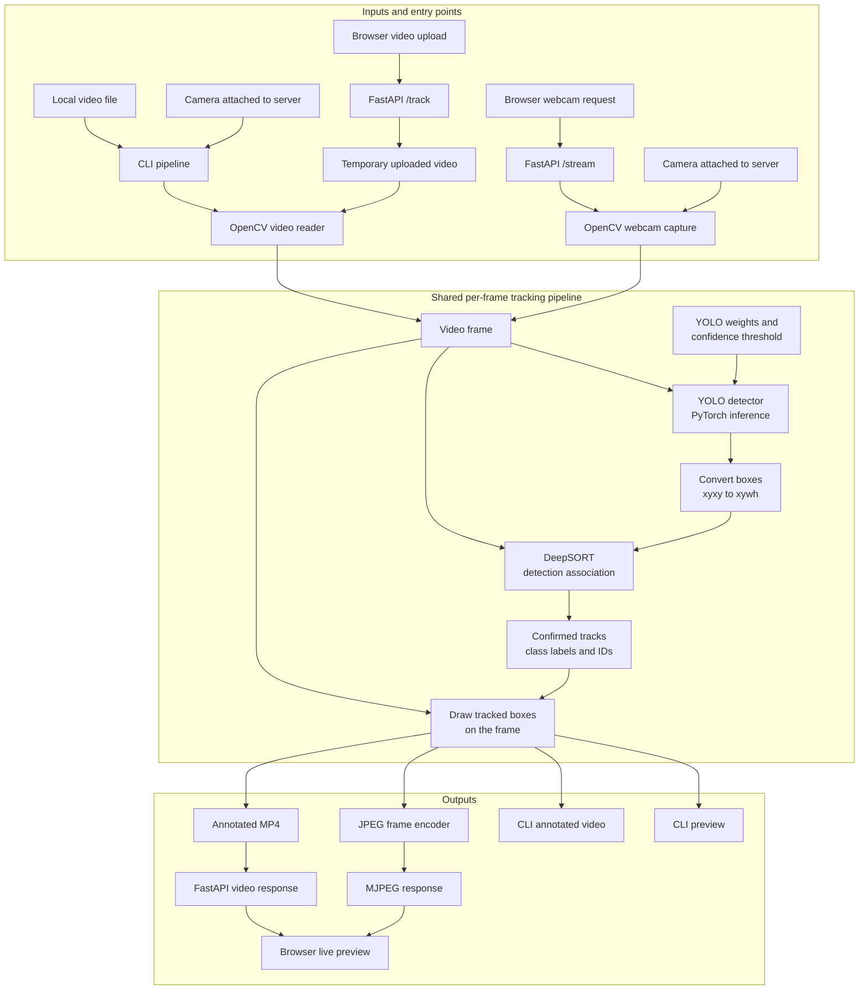

# Real-Time Object Tracking

A practical video tracking pipeline and HTTP API that combine an Ultralytics YOLO detector with DeepSORT. It detects objects frame by frame, assigns persistent track IDs, draws labeled bounding boxes, and can display or return annotated video.

## Features

- Track objects from a video file or webcam.
- Upload a video to the HTTP API and receive an annotated MP4.
- Stream annotated webcam frames from the HTTP API.
- Use Ultralytics YOLO weights, including the default lightweight `yolo11n.pt` model.
- Associate detections across frames with DeepSORT.
- Preview results or save an annotated MP4.
- Configure the model and confidence threshold from the command line or HTTP API.

## Architecture



The CLI and HTTP API have separate input paths but share the same frame-processing and tracking logic. For uploads, FastAPI saves the file temporarily and OpenCV reads it frame by frame; webcam streaming captures from a camera connected to the server. YOLO detections are converted for DeepSORT, which associates them with the current frame to maintain track identities. The annotated frames are then previewed, saved as video, returned as an MP4 upload response, or encoded as an MJPEG webcam stream. The HTTP API loads YOLO weights on the first tracking request; `GET /health` reports server status without loading the model.

## Requirements

- Python 3.10–3.12 recommended.
- A webcam for live camera input, or a video file.
- PyTorch and its runtime dependencies are installed by Ultralytics. For GPU inference, install the PyTorch build appropriate for your CUDA version by following the [official PyTorch installation instructions](https://pytorch.org/get-started/locally/).

## Setup

```bash
python -m venv .venv
source .venv/bin/activate       # Windows: .venv\Scripts\activate
python -m pip install --upgrade pip
python -m pip install -e .
```

The default model weights are downloaded by Ultralytics on the first run. For CUDA acceleration, first install the matching CUDA-enabled PyTorch build by following the PyTorch instructions above, then install this project with `python -m pip install -e .`.

## Usage

### HTTP server

Start the API locally:

```bash
obj-tracking-server --host 127.0.0.1 --port 8000
```

Check that it is running:

```bash
curl http://127.0.0.1:8000/health
```

Upload a video and save the annotated MP4 response:

```bash
curl -OJ -F "video=@path/to/video.mp4" -F "confidence=0.3" http://127.0.0.1:8000/track
```

View webcam 0 as an MJPEG stream in a browser:

```text
http://127.0.0.1:8000/stream?source=0
```

The webcam must be connected to the machine running the server. On macOS, grant camera access to the app that launched the server (for example, Terminal or VS Code) in **System Settings → Privacy & Security → Camera**, then restart the server.

Interactive API documentation is available at `http://127.0.0.1:8000/docs`.
The tracking studio is available at `http://127.0.0.1:8000/`.

### Command-line pipeline

Track a video and display the annotated preview (press `q` to stop):

```bash
python -m obj_tracking.pipeline --source path/to/video.mp4
```

Save an annotated video:

```bash
python -m obj_tracking.pipeline --source path/to/video.mp4 --output runs/tracked.mp4 --no-display
```

Track a webcam:

```bash
python -m obj_tracking.pipeline --source 0
```

Select another model and confidence threshold:

```bash
python -m obj_tracking.pipeline --source path/to/video.mp4 --model yolo11s.pt --confidence 0.45
```

Alternatively, run from a source checkout without installing it as a package by setting `PYTHONPATH=src`:

```bash
PYTHONPATH=src python -m obj_tracking.pipeline --source path/to/video.mp4
```

The default `mp4v` output encoder may not be available in every OpenCV build. If output creation fails, install an OpenCV build with MP4 support or use a compatible output environment.

## Notes

- `--source` accepts a local video path or a non-negative camera index such as `0`.
- `--output` is optional; when omitted, results are previewed but not written to disk.
- GPU inference is used when supported by the installed PyTorch/Ultralytics environment; CPU inference also works.

## License

This project is provided under the MIT License. See [LICENSE](LICENSE).
